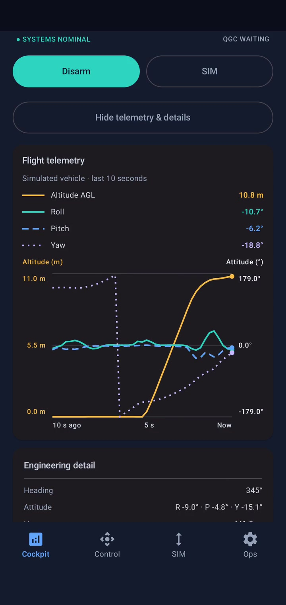
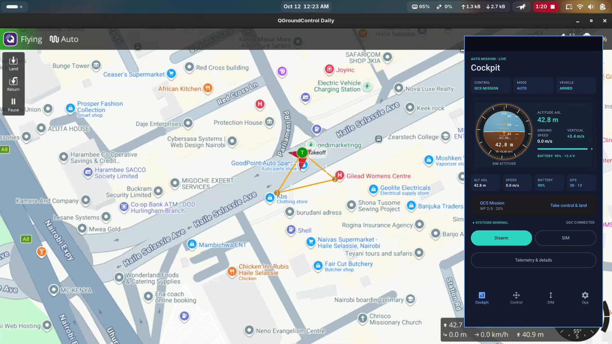
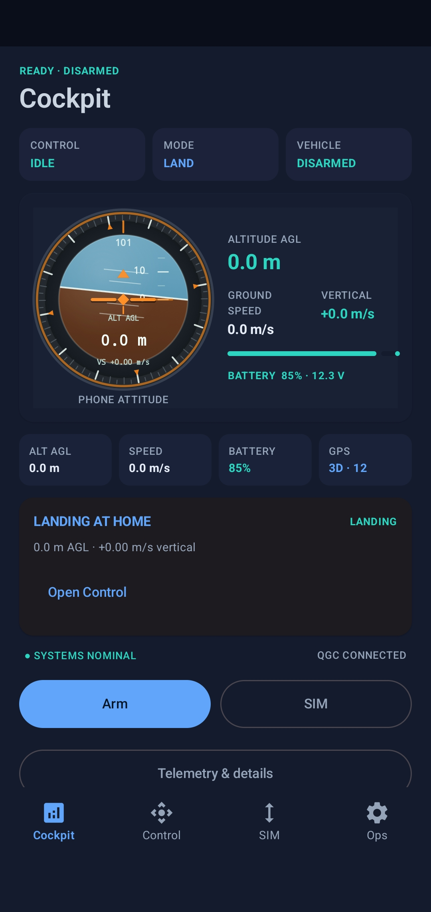
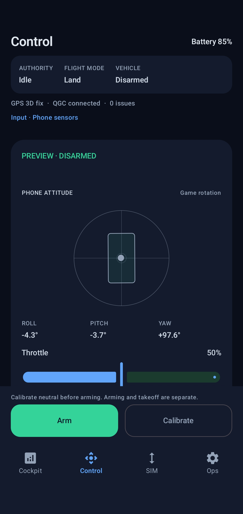
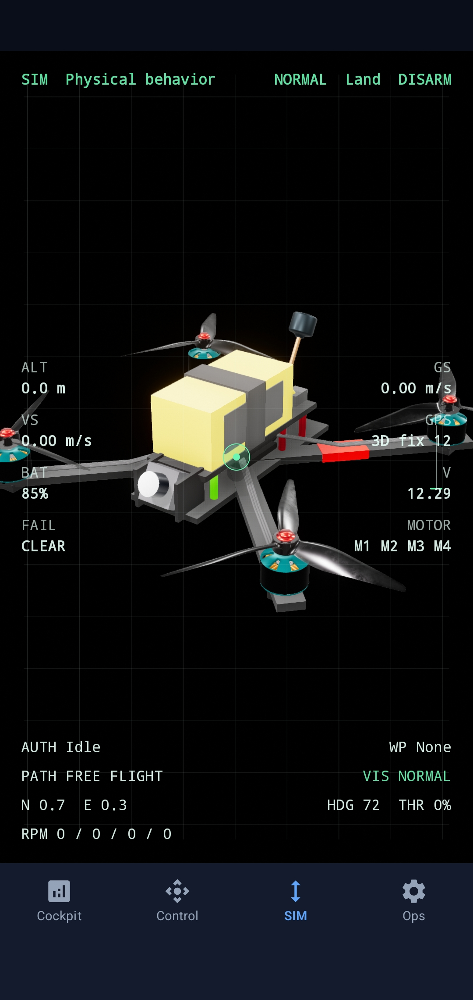
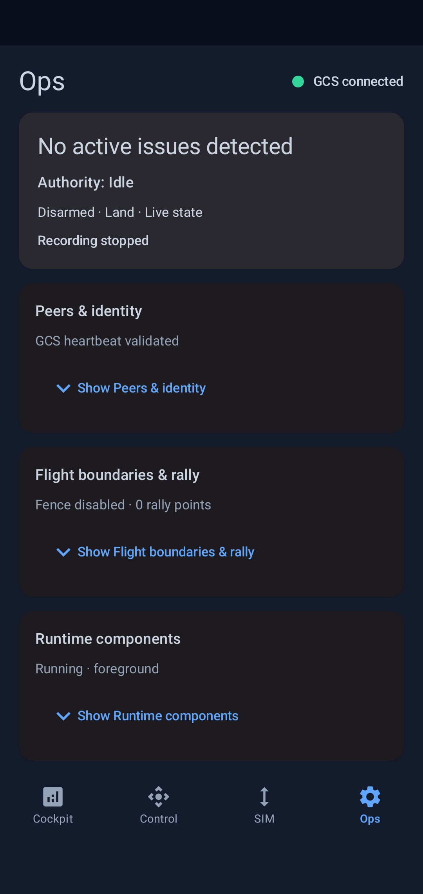

# MAVLab — October 2026 media pack

Prepared from the user's real screen captures for the upcoming README/release refresh. This pack is not a published release or a substitute for build-specific validation. Source captures were made October 11–12, 2026; their exact APK checksum and QGC build identity have not been established for this media pack.

## Videos

### On-device demo

[](mavlab-on-device.mp4)

[MP4](mavlab-on-device.mp4) · Portrait 720 × 1520 · 60 fps · approximately 84 seconds · original recorded audio.

Shows local controls, Cockpit telemetry/charts and the SIM digital twin. It comes from the October 11 capture, which predates the latest fence/rally implementation; do not caption it as demonstrating those features.

Suggested caption: **MAVLab on-device — local controls, live telemetry and the 3D digital twin.**

### MAVLab + QGroundControl

[](mavlab-qgc-demo.mp4)

[MP4](mavlab-qgc-demo.mp4) · Landscape 1920 × 1080 · 30 fps · approximately 118 seconds · original MAVLab phone audio.

QGC fills the frame. The complete MAVLab phone view is overlaid on the right, inside a 2 px blue border, following the existing README demo's composition. The inset is 432 × 912 at x=1458, y=114, with its border occupying 436 × 916 at x=1456, y=112. It intentionally covers part of QGC's right-side panel/instruments; this is a presentation view, not a complete UI tutorial.

The first 1.3 seconds of QGC are trimmed. QGC source t=1.3 and phone source t=0 are approximately aligned using visible mission takeoff/altitude transitions, not filename timestamps. At source phone t=78, MAVLab shows 42.8 m; QGC at source t=79.3 shows 42.7 m. No claim of frame-accurate synchronization is made. Playback is real-time: no speed changes, looping or held final frames. The shorter aligned source sets the endpoint, so this clip does not show the final mission landing/disarm.

Shows a connected session, local flight/landing, QGC plan editing, AUTO mission flight and return initiation with the MAVLab view alongside it. It does not demonstrate a nonempty fence/rally upload or fence-breach recovery, and is not evidence of every MAVLink capability.

Suggested caption: **MAVLab + QGroundControl — plan a mission in QGC and follow the simulated vehicle on the phone.**

Both publication copies use H.264/yuv420p with MP4 fast-start, retain the original phone AAC audio without re-encoding, and remove source metadata/chapters. The QGC capture has no audio track; the composite uses the MAVLab phone capture's sound, aligned with the phone view. Audio is trimmed to each video endpoint and retains the source's initial approximately 0.13-second delay. No music, volume normalization or background-sound removal was added. Any ambient sound present in the source recording remains included at the user's request. Original recordings are unchanged. GitHub README video-player attachment URLs can be added during the later publication step; these local files and clickable posters are the prepared assets, not uploaded attachments.

## Screenshots

These are exact, uncropped 1080 × 2280 JPEG copies. No UI text or state was retouched.

| Cockpit | Control | SIM | Ops |
|---|---|---|---|
| [](screenshots/cockpit.jpg) | [](screenshots/control.jpg) | [](screenshots/sim.jpg) | [](screenshots/ops.jpg) |

The Cockpit capture displays DISARMED/LAND and a landing context card, not an active airborne state. Control displays disarmed phone-input preview. SIM displays disarmed LAND. Ops displays a validated GCS heartbeat, recording stopped and fencing disabled with zero rally points. A green GCS indicator proves neither a successful safety-plan upload nor complete protocol compatibility.

## Source mapping

| Output | Supplied source |
|---|---|
| `mavlab-on-device.mp4` | `/home/ambrose/Downloads/Screen_Recording_20261011_201454_MAVLab.mp4` |
| QGC background | `/home/ambrose/Videos/Screencasts/Screencast from 2026-10-12 00-21-43.mp4` |
| MAVLab inset | `/home/ambrose/Downloads/Screen_Recording_20261012_002344_MAVLab.mp4` |
| `screenshots/cockpit.jpg` | `Screenshot_20261012-002847_MAVLab.jpg` |
| `screenshots/control.jpg` | `Screenshot_20261012-002855_MAVLab.jpg` |
| `screenshots/sim.jpg` | `Screenshot_20261012-002906_MAVLab.jpg` |
| `screenshots/ops.jpg` | `Screenshot_20261012-002916_MAVLab.jpg` |

The four original screenshots reside in `/home/ambrose/Downloads`. Original recordings/screenshots remain outside the repository; only the prepared videos, extracted posters and exact screenshot copies are included here.

## Reproduce

Requires local FFmpeg and ffprobe only; it does not add dependencies to MAVLab. Choose a new output directory: the script refuses to replace existing deliverables.

```bash
bash scripts/prepare-release-media.sh \
  '/home/ambrose/Downloads/Screen_Recording_20261011_201454_MAVLab.mp4' \
  '/home/ambrose/Videos/Screencasts/Screencast from 2026-10-12 00-21-43.mp4' \
  '/home/ambrose/Downloads/Screen_Recording_20261012_002344_MAVLab.mp4' \
  '/home/ambrose/Downloads' \
  '/path/to/new/media-directory' \
  1.3
```

Canonical behavior and limitations remain in [the MAVLink contract](../../../docs/internals/mavlink-contract.md) and [flight boundaries guide](../../../docs/user/flight-boundaries.md). Merge, version selection, updated root README/release notes, media upload, artifact publication and live safety-plan QGC acceptance are separate next steps.

## Media verification — October 12, 2026

- Both sound-enabled MP4s passed complete video/audio FFmpeg decoding with `-v error -xerror`, exit 0.
- ffprobe confirms one H.264/yuv420p video stream and one stereo AAC audio stream in each file. MP4 atom inspection confirms `moov` precedes `mdat` for fast-start playback.
- On-device: 5048 frames at 60 fps, 84.133333 seconds, 12,390,014 bytes.
- QGC composite: 3550 frames at 30 fps, 118.333333 seconds, 8,743,846 bytes.
- Adding sound did not re-encode or change either video stream: compressed-video SHA-256 hashes matched the previous silent copies exactly. Audio packet hashes matched the retained prefix of each original phone recording (3937 and 5540 packets respectively). The source audio start offset was retained to within one millisecond; excess audio at the video endpoint was omitted.
- Extracted posters and sampled composite frames were visually checked for composition, complete phone-frame visibility and source content. Approximate ascent alignment was checked at 42.7/42.8 m; no full-video frame-accuracy certification is claimed.
- All four screenshot copies passed `cmp` against their supplied originals. All eight binary assets passed `sha256sum -c SHA256SUMS` from this directory.
- The rendering script passed `bash -n`; a second invocation against existing deliverables refused to overwrite them before starting a render.

[Source checksums](SOURCE-SHA256.md) preserve provenance. [SHA256SUMS](SHA256SUMS) verifies the prepared binary assets. No application source, root README, release version or Git ref was changed during media preparation; no upload, merge or release was performed.
